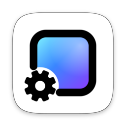
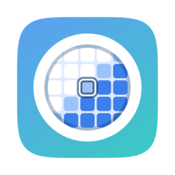

<!-- The public face of https://github.com/MMFoundation. Icons are in profile/assets, in a light and a dark
     version each; WallpaperMachine's are rendered from its App/Resources/AppIcon.icon layers, OhMyShot's are its
     Raycast extension icons. Keep each app's one-liner in step with its repository description and README.
     README.zh-CN.md is this page in 简体中文: change them together. -->

<b>English</b>&ensp;·&ensp;<a href="https://github.com/MMFoundation/.github/blob/main/profile/README.zh-CN.md">简体中文</a>

  Free, open-source apps for the Mac. 
  Native Swift on Apple silicon, licensed GPL-3.0, with all of the source here to read and build.

<table>
  <tr>
    <td width="50%" valign="top" align="center">
       
      <a href="https://github.com/MMFoundation/WallpaperMachine">
        <picture>
          <source media="(prefers-color-scheme: dark)" srcset="https://raw.githubusercontent.com/MMFoundation/.github/main/profile/assets/wallpapermachine-dark.png">
          
        </picture>
      </a>
      <h3><a href="https://github.com/MMFoundation/WallpaperMachine">WallpaperMachine</a></h3>
      

        Wallpaper Engine wallpapers on your Mac: scene, video and web wallpapers from the Steam Workshop, on your desktop.
      

      

        
        
      

      

        <a href="https://www.wallpapermachine.app/download"><b>Download</b></a>&ensp;·&ensp;
        <a href="https://www.wallpapermachine.app">Website</a>&ensp;·&ensp;
        <a href="https://github.com/MMFoundation/WallpaperMachine">Source</a>&ensp;·&ensp;
        <a href="https://github.com/MMFoundation/WallpaperMachine/discussions">Discussions</a>
      

    </td>
    <td width="50%" valign="top" align="center">
       
      <a href="https://github.com/MMFoundation/ohmyshot">
        <picture>
          <source media="(prefers-color-scheme: dark)" srcset="https://raw.githubusercontent.com/MMFoundation/.github/main/profile/assets/ohmyshot-dark.png">
          
        </picture>
      </a>
      <h3><a href="https://github.com/MMFoundation/ohmyshot">OhMyShot</a></h3>
      

        Screenshots, recordings, annotation, pins and on&#8209;device OCR, built to cost nothing while it waits in the menu bar.
      

      

        
        
      

      

        <a href="https://github.com/MMFoundation/ohmyshot#build-and-run"><b>Build from source</b></a>&ensp;·&ensp;
        <a href="https://github.com/MMFoundation/ohmyshot">Source</a>&ensp;·&ensp;
        <a href="https://github.com/MMFoundation/ohmyshot/blob/main/CHANGELOG.md">Changelog</a>
      

    </td>
  </tr>
</table>

  
    Found a bug or have an idea? Open an issue in the app's repository. 
    If WallpaperMachine earns a place on your desktop, you can <a href="https://www.wallpapermachine.app/pricing/">become a Supporter</a>.
  

