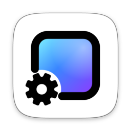
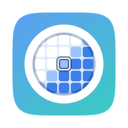

<!-- profile/README.md 的简体中文版，两者一起修改。 -->

<a href="https://github.com/MMFoundation">English</a>&ensp;·&ensp;<b>简体中文</b>

  免费、开源的 Mac 应用。 
  原生 Swift 编写，运行于 Apple 芯片，采用 GPL-3.0 许可；全部源代码都在这里，可以阅读，也可以自己构建。

<table>
  <tr>
    <td width="50%" valign="top" align="center">
       
      <a href="https://github.com/MMFoundation/WallpaperMachine/blob/main/README.zh-CN.md">
        <picture>
          <source media="(prefers-color-scheme: dark)" srcset="https://raw.githubusercontent.com/MMFoundation/.github/main/profile/assets/wallpapermachine-dark.png">
          
        </picture>
      </a>
      <h3><a href="https://github.com/MMFoundation/WallpaperMachine/blob/main/README.zh-CN.md">WallpaperMachine</a></h3>
      

        Wallpaper Engine 壁纸，现已来到 macOS：直接从 Steam 创意工坊获取场景、视频和网页壁纸，在你的桌面上播放。
      

      

        
        
      

      

        <a href="https://www.wallpapermachine.app/download"><b>免费下载</b></a>&ensp;·&ensp;
        <a href="https://www.wallpapermachine.app/zh/">官网</a>&ensp;·&ensp;
        <a href="https://github.com/MMFoundation/WallpaperMachine/blob/main/README.zh-CN.md">源代码</a>&ensp;·&ensp;
        <a href="https://github.com/MMFoundation/WallpaperMachine/discussions">讨论区</a>
      

    </td>
    <td width="50%" valign="top" align="center">
       
      <a href="https://github.com/MMFoundation/ohmyshot">
        <picture>
          <source media="(prefers-color-scheme: dark)" srcset="https://raw.githubusercontent.com/MMFoundation/.github/main/profile/assets/ohmyshot-dark.png">
          
        </picture>
      </a>
      <h3><a href="https://github.com/MMFoundation/ohmyshot">OhMyShot</a></h3>
      

        原生 macOS 截图工具：截图、录屏、标注、贴图和端侧 OCR，常驻菜单栏时几乎不耗电。
      

      

        
        
      

      

        <a href="https://github.com/MMFoundation/ohmyshot#build-and-run"><b>从源代码构建</b></a>&ensp;·&ensp;
        <a href="https://github.com/MMFoundation/ohmyshot">源代码</a>&ensp;·&ensp;
        <a href="https://github.com/MMFoundation/ohmyshot/blob/main/CHANGELOG.md">更新日志</a>
      

    </td>
  </tr>
</table>

  
    发现问题或有想法？请到对应应用的仓库提交 Issue。 
    如果 WallpaperMachine 值得留在你的桌面上，欢迎<a href="https://www.wallpapermachine.app/zh/pricing/">成为支持者</a>。
  

